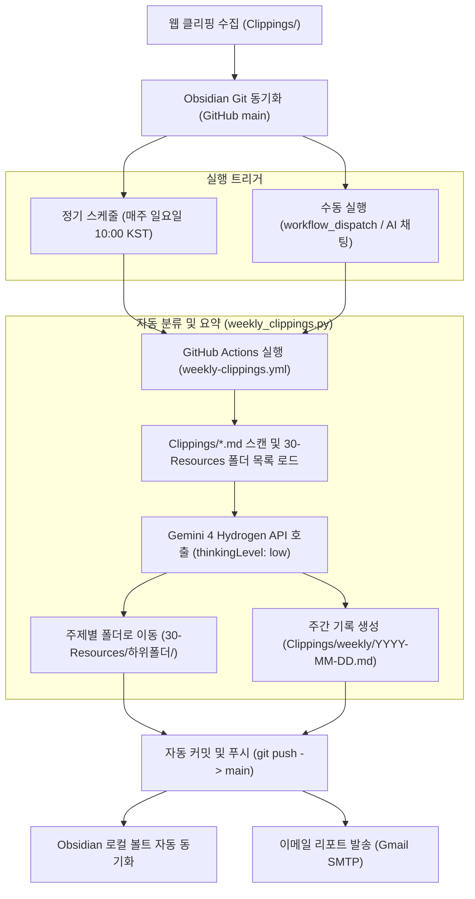

# Obsidian 클리링 노트 주간 자동 정리 파이프라인

웹에서 흥미로운 글이나 논문을 발견할 때마다 Obsidian의 `Clippings/` 폴더에 모아두지만, 정작 주간 단위로 분류하고 요약하는 일은 쉽게 밀리기 마련이다.

이번에 **GitHub Actions + Gemini API(`gemini-4-hydrogen`) + Gmail SMTP**를 조합해, 매주 일요일 오전 10시마다 `Clippings/`의 새 자료를 기존 `30-Resources/` 하위 폴더로 자동 분류하고 주간 요약 노트까지 생성한 뒤 이메일로 리포트를 받는 파이프라인을 구축했다.

---

## 1. 전체 작동 개념도

---

## 2. 설계 원칙과 핵심 포인트

### ① 기존 볼트 구조와 운용원칙 준수
자동화가 기존 정리 체계를 망가뜨리지 않도록 몇 가지 안전장치를 두었다.
- **동적 폴더 참조**: 스크립트가 실행 시점에 `30-Resources/` 아래의 실제 하위 폴더 목록(`32-ai`, `32-economics`, `32-finance`, `32-social`, `31-books` 등)을 읽어와 그 안에서 최우선으로 분류한다.
- **보호 구역 제외**: 블로그·외부 서비스와 연동된 `50-Public/`은 절대 건드리지 않으며, `Clippings/assets`, `Clippings/telegram`, `Clippings/weekly`도 이동 대상에서 제외한다.
- **첨부파일 링크 유지**: 공용 `Clippings/assets/` 폴더를 건드리지 않고 마크다운 노트만 이동해 기존 이미지 참조가 깨지지 않게 유지한다.

### ② 모델 선택과 비용 최적화 (`gemini-4-hydrogen`)
주간 분류와 2~3문장 한국어 요약 작업에는 최신 경량 워크호스 모델인 `gemini-4-hydrogen`을 사용했다.
- **단가**: 유료 API 기준 입력 \$1.50 / 1M 토큰, 출력 \$7.50 / 1M 토큰 (Google AI Studio Free Tier 한도 내 무료 사용도 가능)
- **비용 절감 설정**:
  - 파일당 본문 최대 4,000자까지만 발췌해 입력 토큰을 제한
  - `thinkingConfig.thinkingLevel`을 `"low"`로 지정해 단순 분류·요약 작업에서 불필요한 추론 토큰 소모를 방지
  - 주당 10~15건(월 약 50건) 처리 시 유료 티어 기준으로도 **월 약 \$0.23~\$0.26(약 350원)** 수준으로 운영할 수 있다.

### ③ 주간 요약 노트 자동 생성
분류가 끝나면 `Clippings/weekly/YYYY-MM-DD.md` 파일이 자동으로 생성된다.
- **상단**: 전체 이동 내역을 한눈에 볼 수 있는 마크다운 표(`[[위키링크]]`, 이동 전/후 경로)
- **하단**: 각 문서별 저자·원문 링크·이동 위치·한국어 핵심 요약

### ④ 정기 실행 + 이메일 리포트 + 즉시 실행
- **정기 실행**: GitHub Actions의 `cron: '0 1 * * 0'`(UTC 01:00 = KST 일요일 10:00)으로 매주 자동 실행된다.
- **이메일 리포트**: 작업이 성공하면 Gmail SMTP(Google 앱 비밀번호)로 처리 건수, 이동 경로, 핵심 요약을 메일로 발송한다.
- **즉시 실행**: 일요일까지 기다릴 필요 없이 GitHub Actions의 `workflow_dispatch` 버튼이나 AI 에이전트 채팅에서 바로 실행할 수도 있다.

---

## 3. 구축 구성 요소

| 파일 | 역할 |
| :--- | :--- |
| `.github/scripts/weekly_clippings.py` | `Clippings/*.md` 스캔, `30-Resources/` 폴더 목록 조회, Gemini API 호출, 파일 이동 및 주간 노트·이메일 요약 생성 |
| `.github/workflows/weekly-clippings.yml` | 매주 일요일 10:00 KST 스케줄링, `dry_run` 수동 실행 지원, 자동 커밋·푸시, Gmail SMTP 리포트 발송 |

### 필요한 GitHub Repository Secrets
저장소의 **Settings → Secrets and variables → Actions**에 아래 4개 값만 등록하면 바로 동작한다.
- `GEMINI_API_KEY`: Google AI Studio에서 발급한 API 키
- `MAIL_USERNAME`: 발송용 Gmail 주소
- `MAIL_PASSWORD`: Google 계정의 2단계 인증 **앱 비밀번호** (16자리)
- `MAIL_TO`: 주간 리포트를 받을 이메일 주소

등록 후 Actions 탭에서 `dry_run: true` 옵션으로 수동 실행해 보면, 실제 파일을 옮기지 않고도 API 호출과 이메일 수신이 정상 동작하는지 안전하게 검증할 수 있다.

---

## 4. 마치며

Obsidian에 자료를 모으는 일(수집)은 사람이 하고, 1차 분류와 주간 요약(정리)은 GitHub Actions와 LLM에 맡기는 구조로 바꾸고 나니 `Clippings` 인박스가 쌓이는 부담이 크게 줄었다. 매주 일요일 아침 메일함에 도착하는 주간 리포트를 훑어보며 필요한 글만 다시 꺼내 보는 습관으로 이어가기 딱 좋은 워크플로우다.
