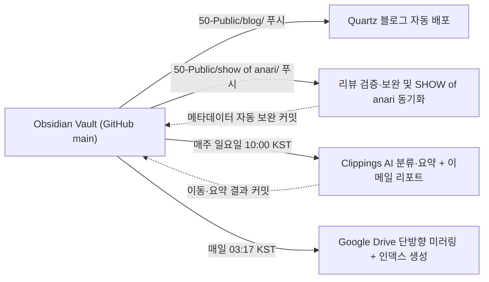

개인 Obsidian 볼트를 비공개 GitHub 저장소에 백업해 두고 쓰다 보면, 자연스럽게 "여기서 바로 배포하고 정리까지 끝낼 수 없을까?"라는 생각이 든다. 현재 내 볼트는 **GitHub을 단일 원본(Single Source of Truth)**으로 삼아, 4개의 GitHub Actions 워크플로우가 각자 역할을 나눠 자동으로 돌아가는 구조다.

---

## 전체 구조

---

## 한눈에 보기

| 자동화 | 트리거 | 주요 역할 |
|---|---|---|
| **블로그 자동 발행** | `50-Public/blog/**` 푸시 / 수동 | 공개 글을 Quartz 블로그 저장소로 동기화해 배포 |
| **리뷰 사이트 동기화** | `50-Public/show of anari/**` 푸시 / 수동 | 감상 리뷰 메타데이터 검증·보완 후 웹 프로젝트에 반영 |
| **주간 클리핑 정리** | 매주 일요일 10:00 KST / 수동 | `Clippings/` 노트를 Gemini로 분류·요약하고 메일 발송 |
| **Google Drive 미러링** | 매일 03:17 KST / 수동 | 볼트 전체를 Drive로 단방향 백업하고 AI 검색용 인덱스 생성 |

---

## 1. 블로그 자동 발행 (`publish-blog.yml`)

볼트 안의 `50-Public/blog/` 폴더에 글을 쓰거나 수정해 `main`에 푸시하면 자동으로 실행된다.

- 공개 블로그용 Quartz 저장소(`v5` 브랜치)의 `content/`를 최신 `50-Public/blog/` 내용으로 교체한다.
- `index.md`가 비어 있으면 기본 인덱스 페이지를 자동 생성한다.
- 변경된 내용이 있을 때만 커밋·푸시해 불필요한 빌드를 막는다.

---

## 2. 리뷰 데이터 검증 및 동기화 (`sync-folder.yml`)

영화·드라마 감상 기록을 모아두는 `50-Public/show of anari/reviews`가 변경되면, 별도의 웹 사이트([SHOW of anari](https://show.lostineconomics.com)) 저장소와 동기화한다.

- 대상 프로젝트의 검증 스크립트를 먼저 실행해 시즌 숫자 형식이나 감상일 같은 메타데이터 누락·오류를 자동 보완한다.
- 자동 보완이 발생하면 **원본 Obsidian 저장소에도 먼저 커밋**해 양쪽 정합성을 맞춘다.
- 최종 데이터 검증(`npm run validate-data`)을 통과한 뒤에만 대상 저장소에 푸시하며, 동시 변경 충돌 시 `rebase`로 최대 3회 재시도한다.

---

## 3. 주간 클리핑 AI 정리 (`weekly-clippings.yml`)

일주일간 `Clippings/`에 모아둔 웹 스크랩 자료를 매주 일요일 오전 10시(KST)마다 자동으로 정리한다. 자세한 구축 과정은 [[옵시디언 위클리]]에 따로 정리해 두었다.

- Gemini API로 각 노트를 읽고, 기존 `30-Resources/` 하위 폴더 중 가장 알맞은 곳으로 이동시킨다.
- 이동 내역과 2~3문장 한국어 요약을 담은 주간 노트(`Clippings/weekly/YYYY-MM-DD.md`)를 생성해 저장소에 커밋한다.
- 작업이 끝나면 Gmail SMTP로 주간 정리 리포트를 메일로 받아본다.

---

## 4. Google Drive 단방향 미러링 (`gemini-drive-mirror.yml`)

매일 새벽 3시 17분(KST)에 GitHub 볼트를 Google Drive로 단방향 복제해 백업과 외부 AI(Gemini 등) 참조용 지식베이스로 활용한다.

- Git에 추적되는 문서·PDF·이미지·오디오/비디오·Canvas 파일만 선별해 스테이징하고, `.obsidian`이나 설정/에이전트용 파일은 제외한다.
- Drive 복제본에만 전체 목차(`_INDEX.md`)와 최근 30일 변경 목록(`_RECENT_CHANGES.md`)을 자동 생성해 탐색을 돕는다.
- `rclone sync` 실행 전 유닛 테스트와 폴더 권한 검증을 거치며, 삭제는 휴지통 이동 및 1회 최대 100개 제한으로 안전장치를 두었다.

---

## 마치며

결국 내가 직접 손대는 곳은 **Obsidian 볼트 하나**뿐이다. 글을 쓰면 블로그로 나가고, 감상평을 적으면 검증을 거쳐 리뷰 사이트에 올라가고, 스크랩을 던져두면 일요일마다 분류·요약되어 메일로 오고, 새벽마다 Drive에 백업된다. 도구를 늘리기보다 단일 원본 뒤에 작은 자동화를 붙여두니 관리 부담이 훨씬 줄어들었다.
