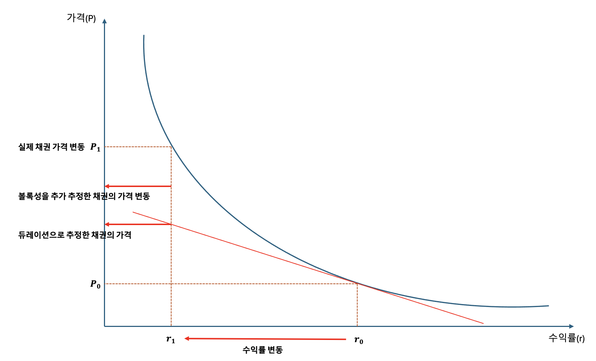

## 수학적 정의 및 유도

채권 가격 $P$는 만기수익률 $y$에 대한 할인 모형으로 정의된다.

$$
P(y) = \sum_{t=1}^T \frac{C_t}{(1+y)^t}
$$

채권 가격 함수의 $y$에 대한 1계 도함수는 다음과 같다.

$$
\frac{dP}{dy} = -\frac{1}{1+y} \sum_{t=1}^T \frac{t \cdot C_t}{(1+y)^t}
$$

볼록성(Convexity)은 가격 함수의 곡률을 측정하기 위해 위 1계 도함수를 $y$에 대해 한 번 더 미분(2계 미분)한 뒤 현재 가격 $P$로 정규화하여 정의한다.

$$
\frac{d^2P}{dy^2} = \sum_{t=1}^T \frac{t(t+1)C_t}{(1+y)^{t+2}} = \frac{1}{(1+y)^2} \sum_{t=1}^T \frac{t(t+1)C_t}{(1+y)^t}
$$

이를 현재 가격 $P$로 나누면 볼록성 계수 $C$가 도출된다.

$$C = \frac{1}{P} \frac{d^2P}{dy^2} = \frac{1}{P(1+y)^2} \sum_{t=1}^T \frac{t(t+1)C_t}{(1+y)^t}$$

테일러 2차 전개(Taylor expansion)를 통해 도출되는 채권 가격 변동률 근사식은 다음과 같다.

$$\frac{\Delta P}{P} \approx \underbrace{-D_{mod}\Delta y}_{\text{듀레이션(1차 선형)}} + \underbrace{\frac{1}{2} C (\Delta y)^2}_{\text{볼록성(2차 곡률)}}$$

### 채권 가격 함수 $P(y)$의 테일러 전개

만기수익률이 현재 수준 $y$에서 $y + \Delta y$로 변동할 때의 채권 가격 $P(y + \Delta y)$를 $y$를 기준으로 2차 항까지 테일러 전개하면 다음과 같다.

$$
P(y + \Delta y) = P(y) + \frac{dP}{dy}\Delta y + \frac{1}{2!} \frac{d^2P}{dy^2}(\Delta y)^2 + \mathcal{O}\left((\Delta y)^3\right)
$$

- $\frac{dP}{dy}$: 만기수익률 $y$에 대한 채권 가격의 1계 도함수 (접선의 기울기)
- $\frac{d^2P}{dy^2}$: 만기수익률 $y$에 대한 채권 가격의 2계 도함수 (곡선의 곡률)
- $\mathcal{O}\left((\Delta y)^3\right)$: 3차 이상의 고차 항(Higher-order terms)으로, $\Delta y$가 충분히 작을 때 무시할 수 있는 미소량

변동 후 가격 $P(y + \Delta y)$에서 변동 전 가격 $P(y)$를 감하여 절대 가격 변동분 $\Delta P$를 정의한다.

$$
\Delta P = P(y + \Delta y) - P(y)
$$

위의 2차 전개식 양변에서 $P(y)$를 차감하고 3차 이상의 항을 생략(근사)하면 다음과 같은 식이 성립한다.

$$\Delta P \approx \frac{dP}{dy}\Delta y + \frac{1}{2} \frac{d^2P}{dy^2}(\Delta y)^2$$

### 4. 상대 가격 변동률($\frac{\Delta P}{P}$)로의 정규화

채권의 가격 단위나 규모에 의존하지 않는 백분율 변동률을 구하기 위해, 식의 양변을 현재 채권 가격 $P$로 나눈다.

$$\frac{\Delta P}{P} \approx \left(\frac{1}{P}\frac{dP}{dy}\right)\Delta y + \frac{1}{2}\left(\frac{1}{P}\frac{d^2P}{dy^2}\right)(\Delta y)^2$$

이 식에서 1계 및 2계 미분 계수를 현재 가격 $P$로 정규화한 두 개의 핵심 계수가 분리된다.

## 2. 금융공학적 의미

### 선형 근사 오차의 보정

듀레이션은 특정 금리 수준에서의 접선(1계 도함수) 기울기만을 반영한다. 따라서 금리 변동 폭($\Delta y$)이 극미할 때는 유효하나, 변동 폭이 커질수록 실제 채권 가격 곡선과의 괴리가 기하급수적으로 확대된다. 2계 도함수를 반영한 볼록성 항 $\frac{1}{2} C (\Delta y)^2$은 이 곡률을 반영하여 비선형 오차를 보정한다.

### 비대칭적 손익 방어 효과 (Convexity Premium)

일반 무옵션 채권은 모든 현금흐름과 시간 계수가 양수이므로 항상 $C > 0$(양의 볼록성)을 가진다. 제곱항 $(\Delta y)^2$은 금리의 변동 방향과 무관하게 항상 양수를 취하므로 다음과 같은 비대칭적 특성이 발생한다.

- **금리 하락 시 ($\Delta y < 0$):** 듀레이션에 의한 가격 상승분에 볼록성 보정분이 가산되어, 실제 가격 상승 폭이 선형 예측치보다 확대된다.
    
- **금리 상승 시 ($\Delta y > 0$):** 듀레이션에 의한 가격 하락분에서 볼록성 보정분이 차감되어, 실제 가격 하락 폭이 선형 예측치보다 축소된다.

즉, 높은 볼록성은 투자자에게 하방 위험은 완화하고 상방 수익은 확대하는 옵션성(Option-like) 가치를 제공한다.

### 포트폴리오 운용 및 자산·부채 종합관리(ALM)의 함의

- **바벨(Barbell) 전략의 우위:** 듀레이션이 동일한 포트폴리오라도 단기채와 초장기채로 분산된 바벨 구조는 중기채 단일물로 구성된 불릿(Bullet) 구조보다 현금흐름 시점($t$)의 분산이 커 볼록성이 높다. 따라서 금리 변동성이 급증하는 장세에서는 바벨 포트폴리오의 위험 조정 성과가 우수하다.
    
- **면역 조건의 완성:** 부채 연계 투자(LDI)에서 금리 급변 시 포트폴리오 가치가 부채 가치 밑으로 하락하지 않기 위한 2차 필요조건은 자산의 볼록성이 부채의 볼록성보다 커야 한다는 점($C_A > C_L$)이다.